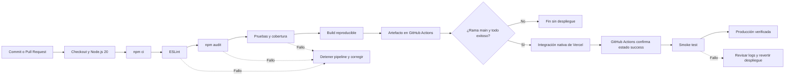

# AA2 — Construcción de un pipeline para SIGR

**Estudiante:** Einer P.  
**Curso:** Gestión del Software — Unidad 3: Automatización y entrega continua  
**Tutor:** ______________________________  
**Fecha:** 25 de noviembre de 2026  
**Repositorio:** https://github.com/einerp/SIGR-ACTUALIZADO

## 1. Introducción y análisis del sistema

SIGR es un sistema realista de gestión para restaurantes. Centraliza autenticación de administradores, menú, inventario, clientes, pedidos y facturación POS, contabilidad y reportes. La integración frecuente de estos módulos sin automatización puede introducir errores de cálculo, accesos no autorizados, pérdida de consistencia del inventario y despliegues inestables.

El pipeline reduce esos riesgos mediante una secuencia repetible que instala versiones exactas de dependencias, revisa el código, ejecuta pruebas, construye un artefacto, despliega y comprueba el servicio. La regla principal es que **ningún cambio llega a producción si falla una validación**.

### Módulos y puntos críticos automatizados

| Módulo | Riesgo controlado | Validación |
| --- | --- | --- |
| Autenticación | Acceso indebido y credenciales débiles | Pruebas de login, sesión, cambio de clave, cookies y middleware |
| Ventas/Pedidos POS | Totales incorrectos y carritos vacíos | Pruebas de subtotal, impuesto, cambio y rechazo de datos inválidos |
| Inventario | Stock inconsistente | Prueba de descuento por venta y reposición por anulación |
| Contabilidad | Ingresos no registrados | Verificación del asiento automático de cada venta |
| Reportes | Resultados calculados sobre datos inválidos | Pruebas de integración sobre los mismos adaptadores |
| API y despliegue | Servicio caído o API expuesta | Health check, HTTP 401 sin sesión y smoke test posterior al deploy |

## 2. Diseño del pipeline CI/CD

### Herramientas

- **Git y GitHub:** control de versiones, ramas, Pull Requests, historial y trazabilidad.
- **GitHub Actions:** orquestación de CI/CD, almacenamiento temporal del artefacto y lectura del estado de despliegue.
- **Node.js 20 y npm ci:** entorno reproducible basado en `package-lock.json`.
- **ESLint:** análisis estático para errores de sintaxis, variables no definidas y código inalcanzable.
- **Node Test Runner y Supertest:** pruebas unitarias e integración HTTP.
- **npm audit:** detección de vulnerabilidades conocidas en dependencias.
- **Integración nativa GitHub–Vercel:** build serverless y despliegue automático de `main`.
- **Supabase:** persistencia PostgreSQL, Storage y protección RLS para usuarios.
- **Smoke test propio:** disponibilidad, contenido del login y protección de la API.

### Diagrama



### Etapas y resultados esperados

| Orden | Etapa | Comando o herramienta | Resultado esperado |
| --- | --- | --- | --- |
| 1 | Integración | `actions/checkout` | Código exacto del commit |
| 2 | Construcción del entorno | `setup-node`, `npm ci` | Dependencias íntegras y repetibles |
| 3 | Validación estática | `npm run lint` | Cero errores de ESLint |
| 4 | Seguridad de dependencias | `npm audit --audit-level=high` | Cero hallazgos altos o críticos |
| 5 | Pruebas | `npm test` | Todas las pruebas exitosas |
| 6 | Build | `npm run build` | Directorio `dist/` con trazabilidad del commit |
| 7 | Empaquetado | `upload-artifact` | Evidencia retenida durante 7 días |
| 8 | Despliegue | Integración nativa GitHub–Vercel | Estado `success` para el mismo commit |
| 9 | Verificación posterior | `scripts/smoke-test.js` | Login 200, health 200, dashboard 401 |

La configuración ejecutable está en `.github/workflows/ci-cd.yml`; no es únicamente pseudocódigo. El job `despliegue` depende de `calidad` y solo se ejecuta para `main`. La API de GitHub se consulta con el `GITHUB_TOKEN` de solo lectura del propio runner, sin guardar un token personal de Vercel.

## 3. Ejecución y evidencias

### Ejecución local reproducible

```bash
npm ci
npm run lint
npm audit --audit-level=high
npm test
npm run build
```

Resultado de la primera validación local:

- 9 pruebas ejecutadas y 9 aprobadas.
- 0 errores de ESLint.
- 0 vulnerabilidades reportadas por npm audit.
- Build generado correctamente en `dist/`.
- Commit inicial publicado: `c249718` (`feat: agregar autenticación y pipeline CI/CD`).

Las capturas y salidas relevantes se conservan en `docs/evidencias/`. La ejecución remota se consulta en **GitHub → Actions → SIGR CI/CD**.

### Simulación y manejo de fallos

1. **Prueba fallida:** se introduce temporalmente una expectativa de total incorrecta. El runner devuelve código distinto de cero, `needs: calidad` impide el deploy y se corrige el cálculo o la expectativa según el análisis.
2. **Vulnerabilidad alta:** `npm audit` falla. Se revisa el árbol con `npm audit`, se actualiza a una versión compatible y se repite toda la validación; no se oculta el hallazgo.
3. **Error de lint:** se detiene antes de compilar. Se corrige la causa, sin deshabilitar reglas para ocultarla.
4. **Smoke test fallido:** se revisan logs de Vercel y variables de entorno. Se revierte al despliegue anterior desde Vercel y se abre un commit correctivo.
5. **Credenciales ausentes:** el login productivo responde que falta configuración y no crea una clave insegura por defecto. Se registran `ADMIN_PASSWORD` y `SESSION_SECRET` como secretos.

## 4. Calidad y seguridad

### Seguridad

- Contraseñas con **bcrypt** y costo 12; nunca se almacena texto plano.
- JWT con emisor, audiencia y vencimiento de 8 horas; cookie `HttpOnly`, `SameSite=Strict` y `Secure` en producción.
- Cambio de credenciales condicionado a la contraseña actual; renovación e invalidación de sesiones mediante la versión de actualización del usuario.
- Límite de 8 intentos de login cada 15 minutos por IP.
- Helmet y Content Security Policy; rutas operativas protegidas por middleware.
- Validación `X-Requested-With` en mutaciones y cookies de mismo sitio para reducir CSRF.
- Tabla `usuarios` con RLS y acceso administrativo solo desde el backend.
- Secretos en GitHub/Vercel, nunca en Git. `npm audit` complementa el control de dependencias.

### Rendimiento y disponibilidad

- El build y las pruebas tienen un límite de 15 minutos para evitar ejecuciones bloqueadas.
- `concurrency` cancela ejecuciones obsoletas del mismo ref y evita despliegues fuera de orden.
- El smoke test tiene tiempo máximo de espera de 15 segundos por solicitud y mide duración total.
- `/api/health` ofrece una comprobación ligera de disponibilidad.
- El artefacto `BUILD_INFO.json` registra commit, fecha y versión de Node para auditoría.
- Como escalamiento se pueden añadir pruebas de carga con k6, umbrales de latencia y monitoreo externo; no se afirma haber ejecutado pruebas de estrés en esta entrega.

## 5. Buenas prácticas y escalamiento

- Ramas temáticas y Pull Requests con revisión antes de fusionar.
- Commits pequeños y descriptivos; producción únicamente desde `main`.
- Dependencias bloqueadas con `npm ci`, artefactos trazables y entornos separados por secretos.
- Entorno `production` de GitHub para aplicar aprobaciones manuales cuando el equipo lo requiera.
- Previews de Vercel para ramas y promoción controlada a producción.
- Reversión desde el historial de Vercel y corrección posterior mediante un nuevo commit.
- Agregar SonarQube/SonarCloud, cobertura mínima obligatoria, escaneo de secretos y Dependabot como siguientes mejoras.
- Incorporar entornos `development`, `staging` y `production`, migraciones versionadas y copias de seguridad antes de migraciones destructivas.

## 6. Conclusiones

El pipeline transforma el despliegue manual en un proceso verificable y repetible. La separación entre calidad y despliegue evita que errores conocidos lleguen a producción, mientras que las pruebas de autenticación y ventas protegen los flujos más críticos del restaurante. La evidencia de cada etapa facilita auditoría, aprendizaje y corrección.

La principal enseñanza es que CI/CD no consiste solo en publicar: exige controles previos, secretos bien administrados, observabilidad posterior y una estrategia de reversa. El resultado es una base que puede crecer de forma colaborativa sin sacrificar estabilidad ni seguridad.
